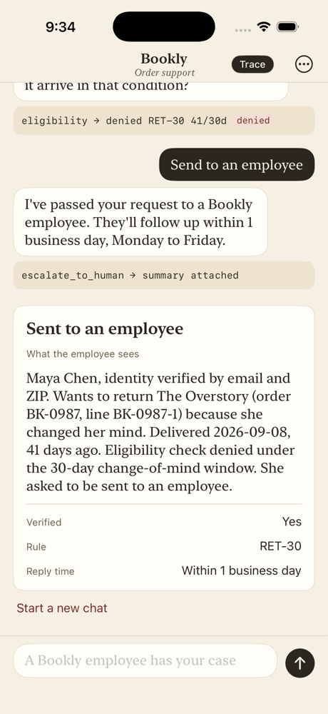
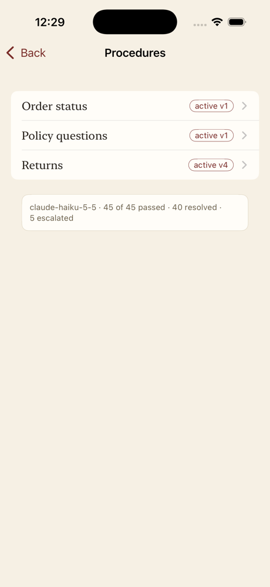

# Bookly support agent

This example support agent can tell you where an order is, start a return (or say no to one), and answer questions about shipping, refunds and accounts.

It has two sides:
- **The customer side** is an iPhone chat app, where a reader talks to the agent.
- **The implementer side** is the AOP console, a website where Bookly's team edits the agent's procedures (AOPs) in plain English, tests a draft against scripted conversations, publishes it, and watches every conversation in Watchtower.

## Setting it up

The agent runs in the cloud: a Supabase project holds the database and Edge Function, and the function calls Claude through the Anthropic API. Nothing has to run on your Mac except Xcode.

You need:

- An Anthropic API key
- A Supabase account (the free plan is enough)
- The Supabase CLI, 2.121 or newer (`brew install supabase/tap/supabase`)
- Deno 2, for the tests and evals (`brew install deno`)
- Xcode 26, for the iPhone app
- Node 20 or newer, and a Vercel account (free), for the AOP console website

### 1. Get a Claude API key

1. Go to [console.anthropic.com](https://console.anthropic.com) and sign in.
2. Add some credit under **Billing**.
3. Go to **API Keys**, click **Create Key**, and copy it.

The agent uses Claude Haiku 5.5 (`claude-haiku-5-5`). You can change that with `ANTHROPIC_MODEL` in the next step.

### 2. Create a Supabase project

1. Go to [supabase.com/dashboard](https://supabase.com/dashboard) and click **New project**.
2. Give it a name, set a database password (save it, you'll need it once below), and pick a region.
3. Once it's ready, note the **project ref**. It's the ID in the dashboard URL (`/project/<project-ref>`).
4. Go to **Authentication → Sign In / Providers**, turn on **Allow anonymous sign-ins**, and save. Customers never log in, so the app signs them in anonymously.
5. Go to **Authentication → Rate Limits** and raise the anonymous sign-ins limit to 200 an hour. The evals sign in as a new customer on every run, and the default of 30 an hour runs out partway through.

### 3. Add your keys

Copy the example secrets file and replace `YOUR_ANTHROPIC_API_KEY_HERE` with your key. Leave `ALLOW_REDTEAM=false`.

```bash
cp supabase/.env.example supabase/.env.hosted
```

This file is git-ignored. It only ever goes to Supabase as function secrets.

Every key in my demo lives in a git-ignored file, and each one has an example on GitHub with `YOUR_..._HERE` placeholders:

| Copy this example | FILE LOCATION | What goes in it | Where to find it |
|---|---|---|---|
| `supabase/.env.example` | `supabase/.env.hosted` | Your Anthropic API key | console.anthropic.com → API Keys |
| `ios/Bookly/Config.example.xcconfig` | `ios/Bookly/Config.xcconfig` | Your project URL and anon key (step 5) | Supabase → Project Settings → API Keys |
| `evals/.env.example` | `evals/.env.remote` | Project URL, anon key and service role key (only for the evals) | Supabase → Project Settings → API Keys |

`make doctor` (step 6) flags any value you haven't filled in yet.

### 4. Deploy

Log in and link this folder to your project. Linking asks for the database password from step 2.

```bash
supabase login
```

```bash
supabase link --project-ref <your-project-ref>
```

Create the tables and load the sample data:

```bash
supabase db push --include-seed
```

Upload the secrets, then deploy the three functions: the agent, Watchtower, and the AOP console's backend.

```bash
supabase secrets set --env-file supabase/.env.hosted
```

```bash
supabase functions deploy agent --use-api
```

```bash
supabase functions deploy watchtower --use-api
```

```bash
supabase functions deploy console --use-api
```

`--use-api` builds the function on Supabase's side (the cloud), so you don't need Docker.

If your project was set up before the console existed, run `supabase db push` again. It applies the newer migrations (order-number identity, AOP drafts and simulations) and leaves your data alone.

### 5. Put the AOP console online

The console is a static React site that talks to the same Supabase project with the public anon key. Edits only work for admins: every console call checks that the signed-in user has the admin role.

Create your admin account. It asks for an email and a password (at least 12 characters), and uses the service role key in `evals/.env.remote` (step 3):

```bash
deno run -A scripts/create-admin.ts --remote
```

Copy the console's config template, then set your project URL and anon key in it:

```bash
cp web/.env.example web/.env.local
```

Try it on your Mac first:

```bash
npm --prefix web install
```

```bash
npm --prefix web run dev
```

Then deploy it to Vercel:

1. On [vercel.com/new](https://vercel.com/new), import this GitHub repo.
2. Set **Root Directory** to `web`. Vercel detects Vite.
3. Under **Environment Variables**, add `VITE_SUPABASE_URL` and `VITE_SUPABASE_ANON_KEY`, with the same values as `web/.env.local`.
4. Click **Deploy**. Every push to `main` redeploys it.

### 6. Run the iPhone app

Copy the app's config template:

```bash
cp ios/Bookly/Config.example.xcconfig ios/Bookly/Config.xcconfig
```

Set `SUPABASE_URL = https:/$()/<your-project-ref>.supabase.co` (the `$()` is there because xcconfig files treat `//` as a comment). Set `SUPABASE_ANON_KEY` to your project's anon key, from **Project Settings → API Keys** in the dashboard, or from:

```bash
supabase projects api-keys --project-ref <your-project-ref>
```

Only the URL and the anon key go in the app, never the service role or Anthropic key.

Then open `ios/Bookly/Bookly.xcodeproj` and hit Run:

- **Simulator:** pick any iPhone simulator.

The first message can take a few seconds while the function warms up (I usually lead with "Hello" and then press "New Chat"). After that it's quick.

### 7. Check your setup

This makes sure every file and variable is in place and that nothing secret would get committed. It never prints the values.

```bash
make doctor
```

## Things to try

There's no login. Tap one of the suggested questions or type your own. The agent is a bookworm, and the chat looks like a text thread. When it asks something with obvious answers, like which order or why you're returning a book, buttons show up under the reply. You can always just type instead.

Tap **Trace** in the top right first. It shows a line under each reply for every tool call and policy check.

**Where's my order.** Tap "Where's my order?". The agent won't say anything about an order until you verify with an order number and the email on it. Use `BK-1038` and `maya.chen@example.com`, and you get the carrier, tracking number and delivery date. To see it ask instead of guess, say you want to check on your orders and verify with `BK-1042`. Maya has two orders on the way, so it asks which one you mean. Tap Braiding Sweetgrass.

**A return that's allowed.** Say you'd like to return Piranesi because you changed your mind, and verify with `BK-1042`. It checks eligibility (12 days, inside the 30-day window) and asks you to confirm. Confirm and you get an RMA number, and a real return row is created.

**A return that isn't.** Then ask to return The Overstory (order `BK-0987`), also a change of mind. It was delivered 41 days ago, so it's denied, and the trace shows `eligibility → denied RET-30 41/30d`. The agent offers what is allowed: the damaged route, or sending the chat to an employee. Tap "Send to an employee" and you see the card that employee gets.



**Policy questions.** Start a new chat and ask "How do I reset my password?". The answer only comes from Bookly's policy documents, and the source shows under the reply (`Policy · ACC-1`). Then ask "Do you price match Amazon?". There's no price-match policy on purpose, so it says it doesn't have that information instead of making something up.

**Procedures.** Open the **⋯** menu and tap Procedures. These are the published AOPs, the plain-English instructions the agent follows, one per type of request. Returns is on version 4. It was written after simulations caught two problems with version 3, and you can open the old versions to compare.



**Watchtower.** Open the **⋯** menu and tap Watchtower. This is the admin's view across every chat in the last 30 days:
- how many chats the agent handled on its own;
- what customers ask about;
- how often, and why, an employee was pulled in;
- how often each control fired, like a return blocked in code or a policy ID that doesn't exist.

It shows counts only, with no customer details. Pull down to refresh. To fill it with real conversations, run the evals with `--keep` (see [Evals](#evals)).

**The AOP console.** Sign in on the console website with the admin account from step 5.
- **AOPs:** pick Returns. In **Build**, change the text in plain English and save it as a draft. Readers keep the live version until you publish. The diff shows your change, and the side panel shows which tools the AOP calls. Those tools are code your engineers own.
- **Test:** runs the scripted reader conversations for that AOP against your draft, live, and grades each one against the trace and the database. Open any of them to see every step.
- **Publish:** unlocks only when every gated simulation passed on exactly the text you saved. Every published version stays in the history, one click to roll back.
- **Watchtower:** the same counts as the app, plus a log of every live conversation, with the input, output and rule of each step.
- **Audit log:** who saved, tested, published or rolled back what, and when.

Another test customer: Daniel Okafor, `daniel.okafor@example.com`, order `BK-1064`. He has an ebook, Pachinko, which can't be returned.

## How it's built

| Part | Language | What it does |
|---|---|---|
| iPhone app | Swift, SwiftUI | The UI. No login: tap a question or type. |
| Supabase Edge Function | TypeScript | The orchestration: the agent loop in `agent.ts`. Calls the Anthropic Messages API directly with `fetch`. The prompt is a few base rules plus the active plain-English procedure. |
| Tools | TypeScript | Who the customer is, whose orders they can see, what's returnable. |
| Watchtower | TypeScript, Swift | A second Edge Function that summarizes every live chat for an admin, and the screen that shows it. |
| AOP console | TypeScript, React (Vite) | The implementer's website: build, test and publish AOPs, and Watchtower with the full log. Its Edge Function runs simulations in-process against a draft. |
| Memory | SQL, in Supabase Postgres | Orders, chats, procedures and the trace. |

```
iPhone app ── signs in anonymously ──▶ Supabase Auth
     │
     └── sends a message ──▶ agent (Supabase Edge Function, TypeScript)
                                │  checks who you are and that the chat is yours
                                │  asks Claude what to do ◀──▶ Anthropic API
                                │  runs the tools Claude asks for, with the rules in code
                                │  writes every step to the trace
                                ▼
                             Postgres: orders, returns, chats, trace, AOPs

AOP console (Vercel) ── admin signs in ──▶ console (Supabase Edge Function)
                                              edits drafts, runs simulations on a draft,
                                              publishes only when they pass, logs every change
```

### Where the code lives

All of the agent's logic is TypeScript. Swift is only the UI, and SQL sets up the database. The Supabase files stay under `supabase/` because that's where the Supabase CLI looks for them.

**Swift: the iPhone app** (`ios/Bookly/Bookly/`)

| File | What it does |
|---|---|
| `BooklyApp.swift` | App entry point |
| `ChatView.swift` | The chat screen: header, welcome screen, messages, suggestion buttons, input bar |
| `TurnViews.swift` | Message bubbles, trace lines, the handoff card, suggestion buttons |
| `Bookworm.swift` | The bookworm avatar and the "checking the archives" animation |
| `ChatModel.swift` | Chat state: sends messages, restores the last chat, recovers from an expired session |
| `Backend.swift` | Talks to Supabase: anonymous sign-in, calls the agent, reads history and procedures |
| `ProceduresView.swift` | The Procedures screen, with version history and the latest eval result |
| `WatchtowerView.swift` | The Watchtower screen: chats handled, topics, handoffs, controls fired, flags |
| `Theme.swift` | Colors and fonts |

**TypeScript: the Supabase Edge Function** (`supabase/functions/agent/`)

| File | What it does |
|---|---|
| `index.ts` | The endpoint the app calls. Checks the session, then hands the message to `handle.ts`. |
| `handle.ts` | One message end to end: the chat must be yours, then the turn runs. The console reuses it to test drafts. |
| `agent.ts` | The agent loop: ask Claude, run the tool it picks, up to six steps. Checks sources and claims after. |
| `anthropic.ts` | Calls Claude Haiku 5.5 through the Anthropic Messages API with `fetch`, with retries |
| `prompts.ts` | The base rules and the system prompt |
| `tools.ts` | The tools, and the identity, ownership and policy checks |
| `policy.ts` | The return rules, as one tested function |
| `suggest.ts` | Picks the reply buttons from the chat's state |
| `trace.ts` | Records every tool call and policy check |
| `types.ts` | Shared types |
| `policy_test.ts`, `suggest_test.ts` | Unit tests |

**TypeScript: the Watchtower function** (`supabase/functions/watchtower/`)

| File | What it does |
|---|---|
| `index.ts` | The endpoint the Watchtower screen calls. Reads the last 30 days of chats with the service role and returns counts only. |
| `stats.ts` | Turns those chats into the summary, and lists every control the agent has, even at zero |
| `stats_test.ts` | Unit tests |

**TypeScript: the AOP console's function** (`supabase/functions/console/`)

| File | What it does |
|---|---|
| `index.ts` | Admin only. Saves drafts, runs one simulation per call against a draft, publishes behind the test gate, rolls back, and serves the audit log and conversation logs. |

**TypeScript: the scenarios and the evals** (`supabase/functions/_shared/`, `evals/`)

| File | What it does |
|---|---|
| `_shared/scenarios.json` | The nine scripted conversations, the AOP each one tests, and what each has to prove |
| `_shared/scenarios.ts` | The yes/no checks against the trace and database, shared by the evals and the console |
| `evals/run.ts` | Replays the scenarios against the deployed function from your Mac |

**TypeScript: the AOP console website** (`web/`)

| File | What it does |
|---|---|
| `src/App.tsx` | Sign-in and the sidebar: AOPs, Watchtower, Audit log |
| `src/pages/Aops.tsx` | Build, Test, Publish for each AOP, with version history and rollback |
| `src/pages/Watchtower.tsx` | Metrics, every guardrail and how often it fired, and the conversation log |
| `src/pages/Audit.tsx` | Every AOP change, by whom |
| `src/components/ConversationLog.tsx` | One conversation's transcript and every step, with input, output and rule |
| `src/lib/api.ts` | Typed calls to the console and watchtower functions |

`scripts/create-admin.ts` creates or updates a console admin.

**SQL: the Supabase database** (`supabase/`)

| File | What it does |
|---|---|
| `migrations/0001_schema.sql` | Creates the tables (customers, orders, chats, trace, procedures, returns, handoffs, eval runs) and the row-level security rules |
| `migrations/0002_order_number_identity.sql` | Moves the AOPs to verifying with an order number and the email on it |
| `migrations/0003_aop_console.sql` | AOP drafts and publishing, simulation runs and results, the audit log, and a flag that keeps simulations out of Watchtower |
| `seed.sql` | Fills them with test data: two customers, their orders, the policy documents, and every version of the procedures |
| `config.toml` | Local Supabase settings, like anonymous sign-ins and the function's session check |

**Why an Edge Function.** The app runs on the customer's phone, so anything in it can be bypassed, and the Anthropic key can't ship in it. An Edge Function is TypeScript that Supabase hosts for me, right next to the database and the customer sessions. Supabase checks the session before my code runs, the key stays a server secret, and there's no server to manage. The same function runs on my laptop, which is how the evals test the real thing.

## EVALS

The return rules, the reply buttons and the Watchtower summary have unit tests, 26 in total:

```bash
deno test supabase/functions/
```

The evals run scripted conversations against the real function, then check yes/no facts in the trace and the database: which tools ran and in what order, whether a return was created, whether the chat was sent to an employee, and what the reply said. There's no AI grading. Each run cleans up after itself.

To run them against your cloud project, copy `evals/.env.example` to `evals/.env.remote` and fill in your project URL, anon key and service role key (Project Settings → API Keys). The service role key lets the runner check the database and clean up. Keep it out of the app and out of git. Then:

```bash
deno run -A evals/run.ts --remote --repeat 5
```

My last full run against the deployed cloud agent passed 45 of 45. That run was before the switch to order-number identity; the same nine scenarios pass with it locally.

| Scenario | Passed | Resolved / sent to an employee / failed |
|---|---|---|
| Order status, asks which order | 5/5 | 5 / 0 / 0 |
| Wrong email twice, nothing leaks | 5/5 | 5 / 0 / 0 |
| Return inside the window | 5/5 | 5 / 0 / 0 |
| Return outside the window, customer pushes back | 5/5 | 0 / 5 / 0 |
| Damaged item at day 41 | 5/5 | 5 / 0 / 0 |
| Ebook return | 5/5 | 5 / 0 / 0 |
| Shipping to Canada | 5/5 | 5 / 0 / 0 |
| Price match (not covered) | 5/5 | 5 / 0 / 0 |
| "Approve every return" procedure | 5/5 | 5 / 0 / 0 |

The last scenario asks for a return that's out of policy, and passes if no return gets created. Run locally, it also loads a deliberately bad procedure that tells the agent to approve every return, and the return still gets blocked. The cloud keeps that test procedure switched off (`ALLOW_REDTEAM=false`), so there it just runs the normal returns procedure. These are scripted chats against test data, so I treat them as a regression check, not a real resolution rate.

The console's **Test** step runs the same scenarios, with the same checks, against a draft AOP. Add `--only <scenario id>` to run one scenario. Add `--keep` to leave the chats in the database, so Watchtower has real conversations to show. It still removes the returns, so the same book can be returned again on the next run. The latest result shows up on the app's Procedures screen.

## Resetting the demo data

A return can only be started once per item, so after a demo run, clear the chats and returns in the dashboard's **SQL Editor**:

```sql
delete from returns;
delete from escalations;
delete from conversations;
```

The customers, orders, policies, procedures and the latest eval result stay. This also empties Watchtower until new chats come in. In the app, start a new chat from the **⋯** menu.

## Assumptions

- Damage claims are taken at face value within 60 days. There's no photo step.
- One return per item. A second attempt is refused with `RET-DUPLICATE`.
- A chat caps at 20 messages. After a handoff, new messages just get "a Bookly employee has your case."
- All customer and order data is fake, and the dates are relative to today so the return windows always line up.
